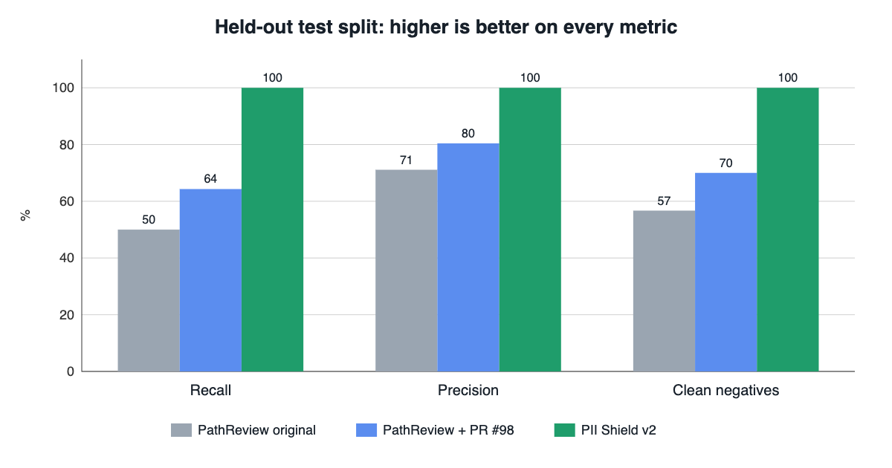

# PII Shield

**A safer PII scrubber for text that's about to be sent to an LLM.** It extends the
`PIIScrubber` from CodePath's PathReview project, where my Module 3 contribution
([PR #98](https://github.com/codepath/pathreview-ai201-fa26-howard/pull/98)) fixed
parenthesized US phone numbers.


## Why this project

PR #98 fixed one bug, but my Unit 10 reflection listed what was still broken in
PathReview's scrubber:

- **International numbers leak.** `+44 20 7946 0958` became `[REDACTED] 20 7946 0958`, so only the country code was hidden.
- **Ordinary resume sentences get redacted.** "Managed 12 engineers on the Way of Code project" became `Managed [REDACTED] of Code project`, because "Way" is a street suffix.
- **Credit cards aren't detected at all.**
- **There was no way to measure any of this.** The unit tests only covered cases someone thought to write.
- **The scrubber was never wired in front of the LLM.** PathReview's architecture doc puts it in the safety middleware chain, but no production code calls it.

This project addresses all five:

| | What it adds |
|---|---|
| **Better detection** (`pii_shield/`) | Rewritten recognizers for phones (US + international), emails, SSNs, **credit cards (new)** and street addresses. Overlaps are resolved in one pass over the original text, not by chained `re.sub` calls. |
| **Evaluation harness** (`eval/`) | 135 hand-labeled examples in three splits, scored for recall, precision, partial leaks and false positives. The original PathReview scrubber and my PR #98 version are included as baselines. |
| **Safe LLM round trip** (`pii_shield/llm.py`) | PII is swapped for typed placeholders like `[PHONE_1]` before the text reaches Claude, then restored in Claude's reply. The model never sees the real values. |
| **Web demo** (`app/`) | Paste text, see what each scrubber hides, try the LLM round trip, and view the evaluation. |
| **Drop-in class** | `pii_shield.PIIScrubber` has the same `scrub()` / `detect()` interface as PathReview's, so it can replace it directly. |

## Results

On the held-out test split, which was written and frozen before any v2 code existed:



| Metric | PathReview original | PathReview + PR #98 | PII Shield v2 |
|---|---:|---:|---:|
| **Recall** (PII fully hidden) | 50% | 64% | 100% |
| &nbsp;&nbsp;EMAIL (7) | 7/7 | 7/7 | 7/7 |
| &nbsp;&nbsp;PHONE (15) | 4/15 | 10/15 | 15/15 |
| &nbsp;&nbsp;SSN (4) | 4/4 | 4/4 | 4/4 |
| &nbsp;&nbsp;CARD (5) | 0/5 | 0/5 | 5/5 |
| &nbsp;&nbsp;ADDRESS (11) | 6/11 | 6/11 | 11/11 |
| Partial leaks | 11 | 9 | 0 |
| **Precision** (redactions that were PII) | 71% | 80% | 100% |
| **Clean negatives** (30 lines with no PII) | 17/30 | 21/30 | 30/30 |
| **F1** | 0.59 | 0.71 | 1.00 |

The perfect v2 score needs context, and the [Limitations](#limitations) section gives it.
In short, I wrote the test set myself, so 100% means v2 handles every case I thought of.
It does not mean v2 is complete. Every miss and false positive, line by line, is listed in
[`eval/RESULTS.md`](eval/RESULTS.md).

## How to run it

You need Python 3.10 or newer. Everything below runs offline. An API key is only needed
if you want the LLM round trip to call Claude.

```bash
git clone https://github.com/pierremerry15/pii-shield.git
cd pii-shield
python -m venv .venv
source .venv/bin/activate          # Windows: .venv\Scripts\activate
pip install -r requirements.txt
```

**Run the web demo**

```bash
uvicorn app.main:app --reload
```

Then open <http://localhost:8000>. Click a sample (or paste your own text), then **Scan**.

**Turn on the real LLM call (optional)**

```bash
export ANTHROPIC_API_KEY=sk-ant-...     # Windows PowerShell: $env:ANTHROPIC_API_KEY="sk-ant-..."
uvicorn app.main:app --reload
```

Without a key, **Send safely** runs as a dry run and shows the exact prompt that would be
sent, so you can check that no PII is in it. The model defaults to `claude-haiku-5-5`. To
change it, set `PII_SHIELD_MODEL`.

**Run the evaluation**

```bash
python -m eval.run_eval --chart
```

This prints the tables, rewrites `eval/RESULTS.md` and `eval/results.json`, and redraws
`docs/eval_chart.png`. It refuses to run if `eval/data/test.txt` has been edited since it was frozen.

**Run the tests and linter**

```bash
pytest -q          # 72 tests
ruff check .
```

GitHub Actions runs both on Python 3.11, 3.12 and 3.13. It also re-runs the evaluation
and fails if the results differ from the committed ones.

**Use it from Python**

```python
from pii_shield import Shield

shield = Shield()
shield.scrub("Call (555) 201-3344 or +44 20 7946 0123").text
# 'Call [REDACTED] or [REDACTED]'

r = shield.scrub("Email ana@example.com, cell (555) 201-3344", mode="typed")
r.text  # 'Email [EMAIL_1], cell [PHONE_1]'
shield.restore("I'll reach out at [EMAIL_1].", r.mapping)
# "I'll reach out at ana@example.com."
```

## Screenshots

**Same text, three scrubbers.** The original leaks `(555) 201-3344`. PR #98 hides it but
cuts the London number off after `+44` and redacts "12 engineers on the Way". v2 hides
every PII value and leaves the prose alone.


**What v2 found**, color-coded by type.


**Prose that only looks like PII.** Both PathReview versions redact parts of these
sentences. v2 leaves them alone.


**The LLM round trip.** The left panel is exactly what the model receives. No phone
numbers, emails or addresses are in it. This screenshot is a dry run (no API key).


**Evaluation panel**


The full page is in [`docs/screenshots/01-overview.png`](docs/screenshots/01-overview.png).

## How it works

```
text ──► every recognizer runs on the ORIGINAL text ──► candidate spans
                                                          │
                     longest span wins, then priority ◄───┘   (resolve)
                                                          │
             scrub(mode="redact") → "[REDACTED]"          ▼
             scrub(mode="typed")  → "[PHONE_1]" + mapping ──► LLM ──► restore() ──► reply
```

**Why one pass instead of chained `re.sub`.** PathReview runs each pattern over the
previous pattern's output, so `detect()` and `scrub()` can disagree, and a later pattern
can match pieces of an earlier `[REDACTED]`. v2 detects everything on the original text,
picks a non-overlapping set, and builds the output once.

**What changed in each recognizer, and why** (details in
[`pii_shield/recognizers.py`](pii_shield/recognizers.py)):

| Type | Change |
|---|---|
| Phone (US) | PR #98's pattern, plus one numbering-plan rule: US area codes never start with 0 or 1. That stops `100 200 3000 items` from being read as a phone number. |
| Phone (intl) | New pattern: a country code, then up to six groups separated by one space, dot or hyphen, with 8 to 15 digits in total. PathReview's version stopped at the first space. |
| Email | Fixed PathReview's `[A-Z\|a-z]` class, which accepted a literal `\|` in the domain. A match can't start in the middle of a longer token. |
| SSN | Also rejects area numbers 900–999, which are never issued. |
| Card | **New.** A 13–19 digit run that passes the Luhn checksum *and* matches a card network's prefix and length. The network rule keeps a 14-digit order ID that happens to pass Luhn from being redacted. |
| Address | Same suffix list as PathReview. The match is now case-sensitive, and every word between the number and the suffix must be capitalized (or be a direction like `NW` or an ordinal like `42nd`). Units such as `Apt 3B` and `Suite 4200` are included in the span. |

**Why typed placeholders.** With plain `[REDACTED]`, the model can't tell a phone number
from an email, and it can't tell two phone numbers apart. With `[PHONE_1]` / `[PHONE_2]` it
can write "call [PHONE_1]", and `restore()` puts the real number back. If the model invents
a placeholder that doesn't exist, such as `[PHONE_9]`, it is left as-is and reported in
`unknown_placeholders`. It is never filled in with a guess.

## Evaluation method

- **Data.** Three splits in [`eval/data/`](eval/data), written with inline markup such as
  `{{PHONE|(555) 201-3344}}`. The parser computes character offsets, so gold spans can't be
  off by one. Every value is fictional: 555 numbers, `example.*` domains, and published
  card-network test numbers.
  - `test.txt` (65 lines: 42 PII values, 30 negative lines). Written before v2 existed.
    Its SHA-256 hash is checked on every run ([`FROZEN.md`](eval/data/FROZEN.md)).
  - `dev.txt` (62 lines). v2 was tuned against this split only.
  - `limits.txt` (8 lines). Cases v2 is known to get wrong, kept so the report shows them.
- **Metrics.** Labels are ignored. What counts is whether the characters were hidden.
  - A value is **protected** only if *every* character is covered. Hiding `+44` but leaving
    `20 7946 0958` counts as a **partial leak**, which is a miss.
  - **Precision** is the share of redacted spans that overlap real PII.
  - **Clean negatives** is the share of PII-free lines left completely untouched.
- **Baselines.** [`baselines/`](baselines) holds PathReview's scrubber before and after
  PR #98. A check in development confirmed the regexes are byte-for-byte identical to the
  originals.

## Limitations

- **I wrote both the test set and v2.** Freezing the test split stops me from tuning
  against it, but I still chose which cases exist. That is why v2 scores 100% on 65 lines.
  A real benchmark would need data written by someone else.
- **Known misses** (`eval/data/limits.txt`): double-spaced numbers (`555  123  4567`),
  7-digit local numbers, obfuscated emails (`jo [at] example [dot] com`), SSNs without
  dashes, PO boxes, and **lowercase addresses** (`123 main st`). The last one is a deliberate
  trade-off. PathReview catches lowercase addresses because it ignores case, and that same
  choice is why it redacts "on the Way of Code". v2 gives up lowercase addresses to stop
  redacting prose.
- **Still a false positive:** a three-digit, three-digit, four-digit number group with a valid
  area code, like `500 200 3000`, is still read as a phone number.
- **Names, dates of birth and IP addresses are out of scope.** Regexes can't find names
  reliably. That would need a named-entity model, which is the natural next step.
- **The LLM round trip relies on the model copying placeholders exactly.** The prompt tells
  it to, and any placeholder it gets wrong is reported, but nothing forces it.

## Project structure

```
pii_shield/        the library: recognizers, Shield (detect / scrub / restore), LLM wrapper
baselines/         PathReview's scrubber before and after PR #98, unmodified
eval/              dataset parser, metrics, runner, labeled data, generated RESULTS.md
app/               FastAPI backend + single-page UI (app/static/index.html)
tests/             72 pytest tests (recognizers, scrubber, LLM with a fake client, eval, API)
docs/              chart, screenshots, demo GIF
```

## Credits

- Extends `safety/pii_scrubber.py` from CodePath's
  [PathReview](https://github.com/codepath/pathreview-ai201-fa26-howard) (MIT), built for
  AI201 Applications of AI Engineering, Fall 2026, Howard University.
- Built with help from Claude Code.

MIT License.
